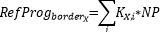

# Hourly merging - additonal outputs
In addition to the CGM computed in [the previous steps](/doc/hourly_task/calculations.md), there are other inputs :

## Reference Program (RefProg)
A Reference Program computation is run for each hour. 

It calculates continental (i.e. no virtual hubs) and virtual hubs exchanges on the borders of all countries in CE zone.

RefProg schedules calculations are done depending on the type of border as follows:

### Virtual hubs exchanges in and outside CE region:
- Retrieve the **CGM Net Positions** artifact file which contains virtual hubs exchanges for each country.
- Modelisation of boundary exchanges follows the following format:
  - **From:**  Country EIC 
  - **To:**    Virtual hub EIC
  - **Value:** Flow on virtual hub connection

  
### Exchanges outside CE region (without virtual hubs):
- Retrieve the **Net Position Forecast** file (PEVF) from task inputs,
- Extract the exchanges out of CE region,
- Sum them to get an area's net position.
- Modelisation of boundary exchanges follows the following format:
  - **From:**  Country EIC 
  - **To:**    Country EIC 
  - **Value:** Flow between countries

### Exchanges in CE region (without virtual hubs):
- Retrieve **CGM Net Positions** artifact, which contains target net position in CE region,
- Get the [Bec Sharing Keys](/doc/globalGridConfigurations.md) information as a matrix ,
- Compute the NP using the formula for the flow on each CE border, noted $X$ ; summing over other countries $i$ :

  - $K$ is the Sharing-Keys-BEC matrix ⇒ $K_{X,i}$ is the coefficient for an exchange between countries $X$ and $i$.
  - $NP$ is the net position of the CGM obtained at the end of CGM calculations. 
- Subtract the virtual hubs exchanges from global exchanges border by border
- Modelisation of boundary exchanges follows the following format:
  - **From:** Country EIC 
  - **To:**  Country EIC 
  - **Value:** Flow between countries

### Exchanges between Italian bidding zones
The reference program should reference Italian bidding zones, not Italy as a whole. 

In addition, there's also a computation for internal Italian exchanges, based on the notion of "internal tie-lines" :
- Get the internal tie-lines from the Italian bidding zones input file,
- For each one :
  - Get its flow from the final CGM,
  - Add it to the flow between zones, using from/to info from the aforementioned file, with Italian bidding zones EICs.

## Merging Logs
What is called merging logs (or merging report) is a report file that contains 4 types of reports :

- **Report for CE hubs :** contains net positions, generation and load quantities, and global balances (global net positions without HVDC) for each Country in CE,
- **Report for Non-CE hubs :** contains initial and final target global net positions, generation and load quantities, and global balances (global net positions without HVDC), for each country outside CE,
- **Report for TSO :** contains global balances, generation and load quantities, only for German TSOs,
- **Flow report on SI-IT :** contains data about the exchanges between [Divača and Padriciano](/doc/hourly_task/step_details/specialPst.md).

## Quality Checks
[Previously mentioned](/doc/overview.md) GLSK and IGM quality checks are also part of the outputs provided by the merging tool.