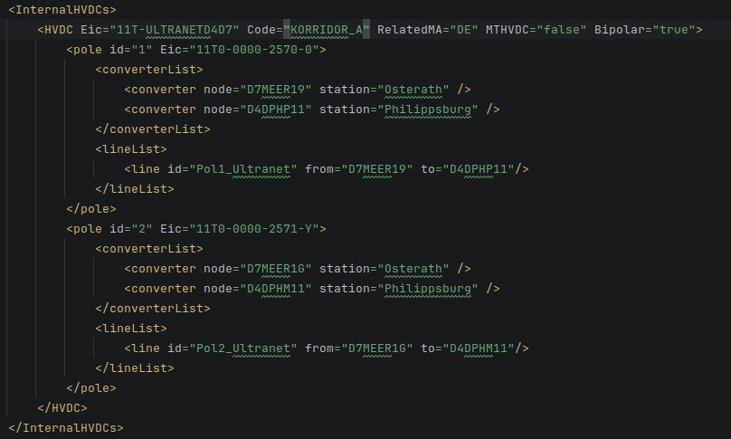

# German internal HVDC
Some German nodes are considered as internal HVDCs, but as they are not X-Nodes, because Germany is modeled as a unique country, we have a different approach to these, as described on this page.
## Design and inputs
To describe the internal HVDCs, we have a dedicated block in the virtual hub configuration as below :

When there is an HVDC block inside, we expect to found in the NPF file, for each line, an entry with an MRID starting with **DE-INT** and ending with the line MRID.

The above configuration describe what is called a P2P HVDC (point-to-point). It means two stations (Osterath and Philippsburg here) are linked through this HVDC, by the defined lines. Graphically, it can be represented like follows : 

There could also be multi-terminal (MT) HVDC as depicted below :

## Mapping and flow calculation

## Outage handling