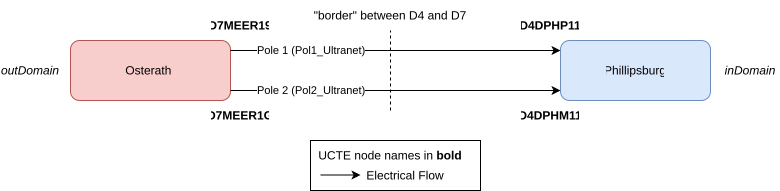
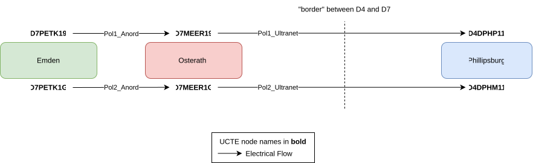

# German internal HVDCs
Some German nodes are considered as internal HVDCs, but they are not X-Nodes, because Germany is modeled as a unique country. We have a different approach to these, as described on this page.
## Modelisation
To describe the internal HVDCs, we have a dedicated block in the virtual hub configuration as below :

The above configuration describe what is called a P2P HVDC (point-to-point). It means two stations (Osterath and Philippsburg here) are linked through this HVDC, by the defined lines. Graphically, it can be represented like follows : 

There could also be multi-terminal (MT) HVDC as depicted below :

## Mapping and flow calculation

When an internal HVDC is encountered in the configuration, the CGM value should be based on the NPF.

For each line of a pole :
- Find the NPF entry that has an MRID starting with **DE-INT** and ending with the line id.
  - If there is none, throw an error
- Get the value at the position corresponding to the task timestamp, that we'll call $f$:
- We attribute $-f$ to the $from$ node, $+f$ to the $to$ node
  - If the node is encountered in another line, $F = \sum_{lines} \pm f(line)$
- Then, update the CGM with this value $F$, depending on the input modelisation :
  - If the node has a generation $\ne 0$ and a load, set the load to $0$ and the generator to $+F$
  - If generation $=0$ and load $\ne 0$, we update the load to $-F$
  - If both $\ne 0$, we set the load to $0$ and the generator to $+F$

As we want the CGM value to be exactly that from the NPF, this treatment is done towards the end of the process as to not have any shifts, losses etc.

The value update is done only if the line is not in outage; a line is considered in outage if one of its two nodes is disconnected from the network. In addition to the usual network status, we also have to check the associated transformers : if there is no connected terminal in any of the transformers, then we also consider this as an outage.